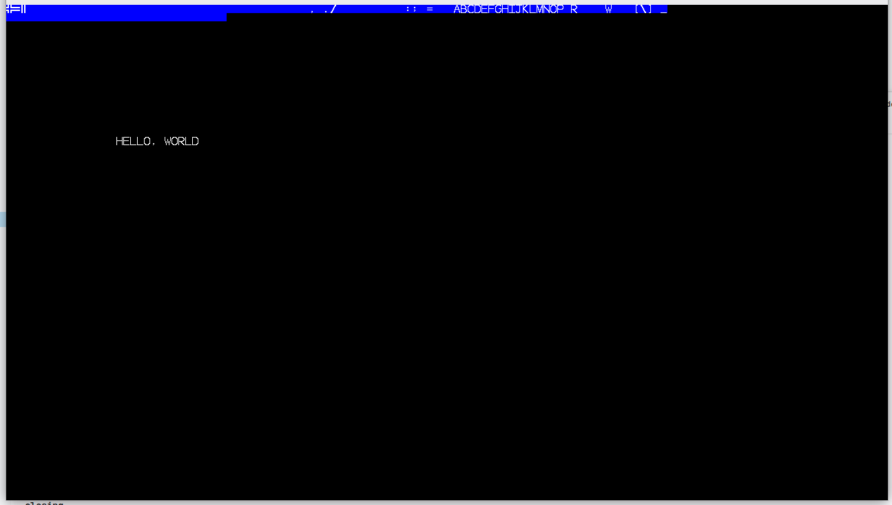

This is a small crate that renders a character map to the screen. You give it a list of up to 256 character textures, a 'character map' which is a grid where each cell defines the character used and three colors, and a look-up table for character colors. The character textures specify how the three colors are used, r mixes the first two colors, then g mixes in the third color (output=mix(mix(color1,color2,tex.r),tex.g)), and the texture alpha defines the alpha. This is inspired by the simplicity of early 8-bit graphics processors, and can be used in programs where you want to partially replicate the look of terminals. The character size is hardcoded at 10x12, idk if there's a good way to make it customizable but there are consts for it in lib.rs and main.fsh.

